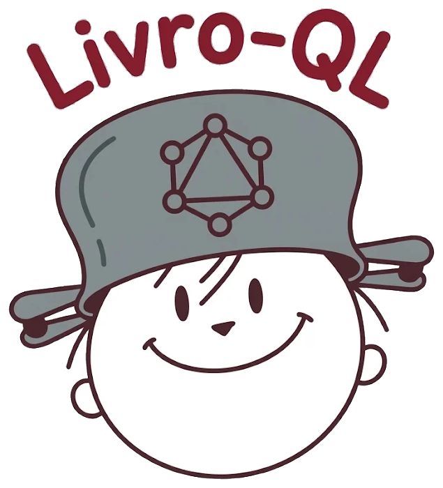

<p align="center">
  
</p>

# Livro-QL, o Meu Catálogo de Livros

Este repositório contém o código-fonte do **Livro-QL**, um app web para registrar livros, autores e o progresso de leitura de cada livro. Ele foi desenvolvido pelo grupo CANDI como exercício de GraphQL da disciplina de Multiplataforma. O objetivo é praticar a modelagem de um schema GraphQL (tipos, enums, inputs, queries e mutations), implementar a API com resolvers e validações e consumi-la com um front-end próprio.

> [!IMPORTANT]
> ## 📖 Respostas do exercício → [RESPOSTAS.md](RESPOSTAS.md)
> As respostas das **perguntas de reflexão (Parte 1)** e da **análise (Parte 4)** estão no arquivo **[RESPOSTAS.md](RESPOSTAS.md)**.

## O grupo CANDI é composto por:

- **Carolina Pichelli Souza :violin:**
- **Fernando Alcantara D´Ávila :video_game:**
- **Guilherme Xavier Zanetti :drum:**
- **Heloísa Pichelli Souza :tada:**
- **Lucas Batista de Sousa :desktop_computer:**
- **Nuno Kasuo Tronco Yokoji :long_drum:**

---

## :high_brightness: Propósito

O Livro-QL é um catálogo pessoal de leitura: você cadastra os livros que quer ler, está lendo ou já leu, acompanha o progresso e dá uma nota de 1 a 5 só para o que terminou. A tela principal busca livros, autores e estatísticas com **uma única requisição GraphQL**, o que mostra na prática a vantagem do GraphQL sobre várias chamadas REST.

## :bulb: Características Principais

- **Catálogo de livros**: lista com título, autor, ano, páginas, status e nota.
- **Filtros e busca**: filtro por status (Todos, Quero ler, Lendo, Lidos) e busca por título, ambos usando variáveis GraphQL. A busca espera 300 ms depois que você para de digitar (debounce).
- **Progresso de leitura**: troca de status direto na lista. A nota (1 a 5) só fica disponível para livros lidos.
- **CRUD de autores**: cadastrar, editar e excluir autores. Não aceita nome vazio nem repetido, e não exclui um autor que ainda tem livros.
- **Painel de estatísticas**: total de livros, livros lidos, nota média e páginas lidas, todos calculados a partir dos livros.
- **Validações no backend**: título vazio, ano no futuro, páginas < 1, autor inexistente, nota fora de 1–5, avaliar livro que não está `FINISHED` e id inexistente. Tudo volta como erro GraphQL, com uma mensagem clara.
- **Feedback na tela**: estados de carregamento, erro (com a mensagem que vem do backend) e lista vazia, além de confirmação antes de excluir.

## 🛠️ Tecnologias Utilizadas:

- **Python + FastAPI**: servidor HTTP da API, que também serve o front-end.
- **Strawberry GraphQL**: definição do schema com tipos, `@strawberry.enum` e resolvers nas classes, além do GraphiQL para testar.
- **HTML, CSS e JavaScript puro**: front-end sem framework, com o JavaScript separado em módulos ES (`type="module"`).
- **GraphQL fragments**: `BookFields` e `AuthorFields` reaproveitam os campos entre as operações.

## :gear: Arquitetura de Software

O backend usa **repository pattern** em três camadas:

```
main.py (resolvers GraphQL)  →  services.py (regras de negócio)  →  repositories.py (dados)
```

- **Resolvers** (`main.py`): os tipos Strawberry, com `Author.books`, `Author.bookCount` e `Book.author` resolvidos nas classes. Eles só repassam a chamada para os services.
- **Services** (`services.py`): concentram as validações e as regras, como "só avalia livro lido" e "não exclui autor com livros".
- **Repositories** (`repositories.py`): só guardam e buscam dados. Os contratos são `Protocol`s, e a implementação atual usa um `dict` em memória. Para usar um banco de dados, basta criar outra classe com os mesmos métodos e trocá-la em `create_services()`. Nenhum resolver muda.

O front-end segue a mesma ideia de separação:

- **`api.js`**: a função genérica `gql(query, variables)`, que trata erros HTTP e o campo `errors`, além das queries e mutations.
- **`ui.js`**: só desenha a tela.
- **`main.js`**: cuida do estado e dos eventos e liga a API à interface.

## 📁 Estrutura do Projeto

```
livro-QL/
├── schema.graphql            # schema em SDL (Parte 1)
├── RESPOSTAS.md              # 📖 RESPOSTAS das perguntas (Partes 1 e 4)
├── catalogo-api/             # backend (Parte 2)
│   ├── main.py               # camada GraphQL + FastAPI + CORS
│   ├── services.py           # regras de negócio, validações e seed
│   ├── repositories.py       # contratos e repositórios em memória
│   ├── models.py             # enum ReadingStatus e registros de domínio
│   └── requirements.txt
└── catalogo-web/             # front-end (Parte 3)
    ├── index.html
    ├── js/
    │   ├── api.js
    │   ├── ui.js
    │   └── main.js
    └── assets/
        ├── logo.png
        └── logo-transparente.png
```

## 🚀 Como Utilizar

1. **Crie o ambiente virtual e instale as dependências:**

    ```bash
    cd catalogo-api
    python -m venv .venv
    # Windows:      .venv\Scripts\activate
    # Linux/macOS:  source .venv/bin/activate
    pip install -r requirements.txt
    ```

2. **Suba o servidor:**

    ```bash
    uvicorn main:app --reload
    ```

3. **Acesse no navegador:**

    - **App:** <http://localhost:8000/>
    - **GraphiQL:** <http://localhost:8000/graphql>

4. **Teste no GraphiQL (exemplos do enunciado):**

    ```graphql
    query {
      books(status: FINISHED, search: "dom") {
        title
        rating
        author { name }
      }
      stats { totalBooks finishedBooks averageRating totalPagesRead }
      authors { name bookCount }
    }
    ```

    ```graphql
    mutation {
      rateBook(id: 1, rating: 9) { id rating }
    }
    # → "Nota inválida (9): a nota deve estar entre 1 e 5."
    ```

## 📝 Notas de Desenvolvimento

- Os dados ficam **em memória**: o seed (`SEED_AUTHORS` e `SEED_BOOKS` em `services.py`) é carregado ao iniciar, e tudo volta ao estado inicial quando o servidor reinicia. Para um autor ou livro ficar fixo, adicione-o no seed.
- O front usa módulos ES, que **não carregam via `file://`**. Por isso o FastAPI serve a pasta `catalogo-web`: abra pelo `http://localhost:8000/`, não pelo arquivo.
- Quando um livro deixa de estar como `FINISHED`, a nota é apagada, porque só se avalia o que foi lido.
- **Desafio extra escolhido:** separar o JavaScript em módulos (`api.js`, `ui.js`, `main.js`). Também usamos fragments e debounce na busca.
- 📖 **As respostas das perguntas do exercício (Partes 1 e 4) estão em [RESPOSTAS.md](RESPOSTAS.md).**

---
